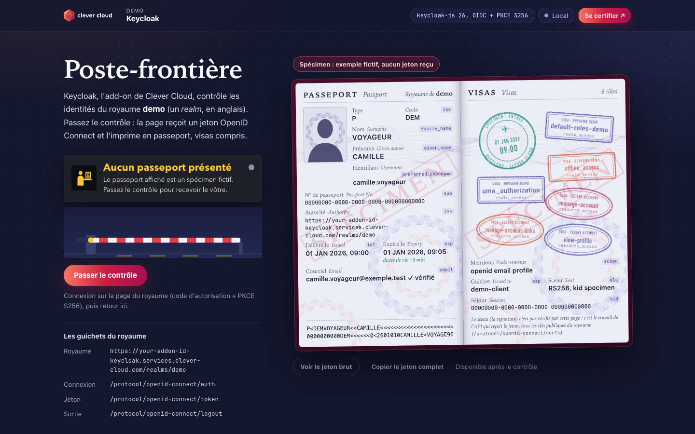
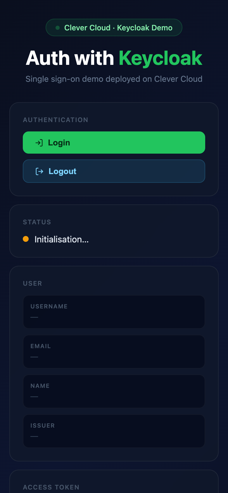

# Poste-frontière — Keycloak add-on and Static runtime on Clever Cloud

> A border post, in one static page and no back end. Before sign-in, the desk shows a **SPÉCIMEN** passport (fictional, clearly marked). **Passer le contrôle** sends the browser to the sign-in page of the **Keycloak add-on** (Authorization Code + PKCE S256); back on the page, the barrier rises and the access token is printed as a passport: `sub` is the passport number, `iss` the issuing authority, `exp` the expiry date with a live countdown, each role a visa stamp, and the machine readable zone is computed from the token. The real JWT stays one click away (**Voir le jeton brut**, full copy), and **Sortir** stamps the exit before Keycloak ends the session. The add-on is a managed Keycloak, created in one command with its own Java app, PostgreSQL and FS Bucket; the page is plain HTML and JavaScript served as-is by the **Static runtime**, with no build and no process. In Keycloak a *realm* is a kingdom (« royaume »): the page plays on it.





**Run it yourself.** The hosted demo was taken down after the presales review (November 2026). The steps in [Deploy on Clever Cloud](#deploy-on-clever-cloud) recreate it from scratch in about 2 minutes (measured: the page and the add-on answered 106 seconds after the first command), plus about 5 minutes of Keycloak console steps.

**Get certified.** This demo runs on Clever Cloud. To deploy your own apps the same way, get certified at the [Clever Cloud Academy](https://academy.clever.cloud/).

## What Keycloak does here

| Where | Keycloak feature | What you see |
|---|---|---|
| Page load | `keycloak.init({ onLoad: 'check-sso', pkceMethod: 'S256' })`: keycloak-js asks the realm whether this browser already has a session, without showing a form | The sign « Contrôle en cours » (amber lamp), then « Bienvenue, … » (green) or « Aucun passeport présenté » (grey). The *Registre du poste* lists each step with its time and call |
| Before sign-in | Nothing yet | The SPÉCIMEN passport: fictional values, but the claims of a real Keycloak 26 token for a new user of a new realm, default roles included |
| **Passer le contrôle** | `keycloak.login()`: Authorization Code flow with PKCE S256, realm `demo`, public client `demo-client` | The sign-in page of the realm, served by the add-on, then back to the page; the code is exchanged at `/protocol/openid-connect/token`, the barrier rises and the entry stamp lands |
| Identity page | `keycloak.tokenParsed`: `family_name`, `given_name`, `preferred_username`, `sub`, `iss`, `iat`, `exp`, `email`, `email_verified` | Each field names the claim it comes from. Passport number = `sub`, authority = `iss` (`https://<id>-keycloak.services.clever-cloud.com/realms/demo`), expiry = `exp` with « valable encore 4 min 58 s ». The two-line zone at the bottom is built from the token with the ICAO 9303 check digits |
| Visa page | `realm_access.roles`, `resource_access.<client>.roles`, `scope`, `azp`, `sid`, and the JWT header (`alg`, `kid`) | One stamp per role (rectangles for realm roles, ovals for client roles); scope, client, session and seal. A note says the signature is not checked by the page: an API checks it with the realm's public keys (`/protocol/openid-connect/certs`) |
| **Voir le jeton brut**, **Copier le jeton complet** | `keycloak.token`, the JWT | The whole token in three colours (header, payload, signature) with its length, then the decoded header and payload. Copy puts the complete token on the clipboard |
| **Renouveler le jeton** | `keycloak.updateToken(-1)`: refresh token grant | A new `exp`, without the sign-in form. When `exp` passes, the expiry field turns red (`onTokenExpired`) |
| **Sortir** | `keycloak.logout({ redirectUri: window.location.origin })` | The red exit stamp, the barrier goes down, then Keycloak ends the session and sends the browser back to the page |

If the sign turns red, « Poste injoignable », about 10 seconds after loading: the realm `demo` does not exist or `config.js` does not point to your Keycloak. keycloak-js gives up waiting for its third-party cookie check (`Timeout when waiting for 3rd party check iframe message`, written in the *Registre du poste* and the browser console); seen on Clever Cloud with the realm missing (with the earlier keycloak-js 22 page), and locally with an unreachable address.

## Deploy on Clever Cloud

You need [clever-tools](https://www.clever.cloud/developers/doc/cli/) (`clever login` done) and the ID of the organisation that will own the resources (`orga_…`, shown in the Console). Run the commands from the repo root: `clever create` links the folder to the new app.

```bash
# 1. The app and its size (Static runtime: nothing is built, no application process)
clever create --type static demo-keycloak --org <org_id> --region par
clever scale --min-flavor nano --max-flavor XS --min-instances 1 --max-instances 2

# 2. Keycloak (plan base, the only one: a Java app, a PostgreSQL and an FS Bucket, created together)
clever addon create keycloak demo-keycloak-sso --plan base --region par --org <org_id> --yes
#    it prints the "Access it" URL, https://<id>-keycloak.services.clever-cloud.com/admin,
#    the admin user name (cc-account-admin) and a temporary password: keep them for the console steps

# 3. Point the page to your Keycloak: the one setting, url in config.js (a static page reads no variable)
perl -pi -e 's#your-addon-id#<id>#' config.js
git commit -am "Point the demo to my Keycloak"

# 4. Deploy
clever deploy
clever domain    # the page's address, app-<uuid>.cleverapps.io, needed by the client below
```

There is nothing to link and no variable to set: the browser talks to Keycloak directly. Then configure Keycloak in its admin console, an owner step, once:

1. Open the "Access it" URL and sign in with `cc-account-admin` and the temporary password; the add-on says you will be asked to change it at the first login.
2. Create a realm named `demo`. The add-on already holds a realm `example`, unused here.
3. In `demo`, **Clients › Create client**: client ID `demo-client`, OpenID Connect; **Client authentication** off (a public client: a browser page cannot keep a secret), **Standard flow** on; **Valid redirect URIs** `https://<app-domain>/*`, **Valid post logout redirect URIs** `+`, **Web origins** `+`.
4. **Users › Create new user** with a username, an email, a first and a last name (they fill the passport), then **Credentials › Set password**, **Temporary** off.
5. Open the page, click **Passer le contrôle** and sign in with that user.

Use the console for these steps: the add-on refuses the password grant of the `admin-cli` client (`invalid_client`), which `kcadm.sh` uses, so the initial account cannot drive the admin REST API from a terminal.

The add-on starts at about €47 per 30 days (provider listing). After the demo, `clever addon delete <addon_id> --org <org_id> --yes` removes it with its Java app, PostgreSQL and FS Bucket (checked on Clever Cloud), and `clever delete --yes` removes the page.

## Variables

The page reads no environment variable. Its settings are in `config.js`, and only `url` changes from one deployment to the next.

| Setting in `config.js` | Value |
|---|---|
| `url` | your add-on, `https://<id>-keycloak.services.clever-cloud.com` (step 3). The repo holds a placeholder, `your-addon-id` |
| `realm` | `demo` |
| `clientId` | `demo-client` |

The *Running on Clever Cloud* panel shows the host and the runtime only: a static page cannot read `CC_APP_NAME`, `INSTANCE_NUMBER` or any other platform variable. It reads « Local » on `localhost`.

The add-on keeps its own settings on its Java app, visible in the Console:

| Variable | Set by | Role |
|---|---|---|
| `CC_KEYCLOAK_ADMIN` | Keycloak add-on | `cc-account-admin`, the initial admin |
| `CC_KEYCLOAK_ADMIN_DEFAULT_PASSWORD` | Keycloak add-on | The temporary password printed at creation |
| `CC_KEYCLOAK_REALMS` | Keycloak add-on | `example` at creation. The docs: a comma-separated list of realms, applied after a restart of the Java app |
| `CC_KEYCLOAK_VERSION` | Keycloak add-on | `26.7.4` when tested (November 2026) |

## Routes

The Static runtime serves the repo root as-is: `/` the page (`index.html`) · `/config.js` the Keycloak settings · `/app.js`, `/passport.js`, `/render.js` the page's ES modules · `/keycloak.min.js` keycloak-js, imported by `app.js` · `/poste.css`, `/cc-brand.css`, `/cc-badge.svg`. On the add-on: `/admin` the admin console · `/realms/demo/protocol/openid-connect/auth`, `/token`, `/logout` the endpoints the page calls, listed on the page under *Les guichets du royaume*.

## Code tour

```
index.html        the page: Clever top bar, booth (sign, barrier, buttons, endpoints), passport, raw token,
                  ledger, Academy visa, Running on Clever Cloud panel, footer. No inline script
config.js         window.KEYCLOAK_CONFIG: url (the one to change), realm demo, client demo-client
app.js            keycloak-js wiring: init check-sso with PKCE S256, login, updateToken, logout, the ledger
passport.js       pure functions: claims -> passport fields, MRZ and ICAO check digits, roles, JWT decoding, the specimen
render.js         drawing: security paper, portrait, stamps, sign, barrier, raw token panel, platform panel
poste.css         the border post's styles
keycloak.min.js   keycloak-js 26, the official adapter as an ES module (not minified), served locally: no CDN
cc-brand.css      Clever Brand Kit, copied as-is (with cc-badge.svg)
test/             node --test: MRZ, check digits (ICAO specimen), claim mapping, JWT decoding
```

No framework, no package, nothing to build. Every value from the token goes through `textContent`.

## Run locally

```bash
python3 -m http.server 8603    # any static server
node --test test/              # passport logic, Node.js 22 or later
```

Then add `http://localhost:8603/*` to the client's valid redirect URIs (web origins `+` follows), set `url` in `config.js`, and open http://localhost:8603. keycloak-js needs a secure context for PKCE: `localhost` or HTTPS, not a LAN address over HTTP. Without a reachable Keycloak, the specimen stays on the desk and the sign turns to « Poste injoignable » after about 10 seconds.

The screenshots above come from such a local run. No Keycloak runs locally: the browser's calls to the realm were answered by a test stub saying "no session" to check-sso, hence the specimen, the placeholder address and « Local ».

MIT License.
